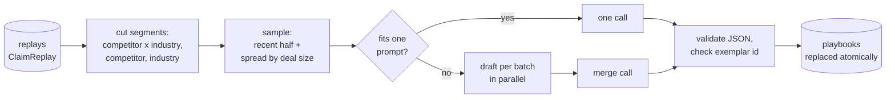

# ClaimScout

**Reads every won deal together and writes a playbook for each competitor and industry.**

One replay tells you how one deal was won. ClaimScout looks across all of them to answer the questions
a rep actually asks before a call: *How do we beat Stackwise? What do logistics buyers always test
first? What does winning against "do nothing" look like?*

It reads the replays written by ClaimReplay, cuts them into segments, and for each segment writes:

| Field | Example |
|---|---|
| `headline` | "Against Stackwise, win on time to value: get a proof of concept running in week one." |
| `buyer_tendencies` | "Security reviews start before the technical evaluation, not after." |
| `winning_moves` | "A side-by-side on the buyer's five most critical tables." |
| `objections` | "Stackwise is cheaper" → "Cost of one bad-data incident vs. the price gap" |
| `watch_outs` | "Deals stalled whenever the security questionnaire sat with us for more than a week." |
| `exemplar_deal_id` | The one deal worth reading in full, checked to be one the model actually saw |

Part of a set of four tools built around *what does a rep need to win the next call?*:
**ClaimReplay** (learn from each win) → **ClaimScout** (patterns across wins) → **ClaimPrep** (pre-call
brief) → **ClaimCoach** (chat coaching and objection role-play).

## How it works



| Module | Responsibility |
|---|---|
| `wins.py` | Reads ClaimReplay's store; tolerant of fields it doesn't know |
| `segments.py` | The three cuts; deals with no competing vendor form a "status quo" segment |
| `sampling.py` | Deterministic sample: newest half plus an even spread across deal size |
| `builder.py` | One segment → one playbook (single call, or drafts + merge), exemplar check |
| `store.py` | Replaces all playbooks in one transaction |
| `pipeline.py` | Orchestration; keeps last run's playbooks if every segment fails |
| `structured.py`, `budget.py`, `llm.py` | Validated JSON output, token budgeting, OpenAI-compatible client |

### Design choices

- **"Status quo" is a competitor.** Winning against a buyer's inertia is a different sale from beating
  another vendor. Deals without a competing vendor are grouped together and get a prompt that frames
  inertia as the thing to beat.
- **A sample that stays current without forgetting.** Half the sample is the most recent wins; the
  other half is spread across deal size so big deals in a small-deal segment still count. It's
  deterministic, so a playbook only changes when the wins change.
- **Patterns, not anecdotes.** The prompt requires two supporting deals for a pattern, and segments
  need at least `MIN_DEALS` wins.
- **Trust, but verify.** The exemplar deal id is checked against the deals actually shown, and dropped
  if the model made one up.
- **Atomic rebuilds, safe failures.** Readers see last run's playbooks or this run's, never a mix. If
  every segment fails, nothing is overwritten.

## Try it

ClaimScout needs replays to read, so run ClaimReplay first (its README has the steps), then:

```bash
pip install -e ".[dev]"
cp .env.example .env            # REPLAY_DB_PATH points at ClaimReplay's output
claim-scout run
claim-scout show                 # one line per playbook
claim-scout show --competitor Stackwise
```

## Development

```bash
pytest       # scripted fake model, in-memory fixtures: no network or API key
ruff check .
```

**Author:** Vihas Adi
